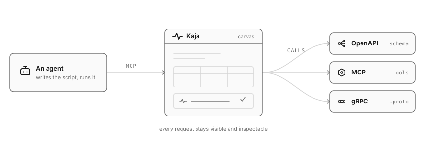
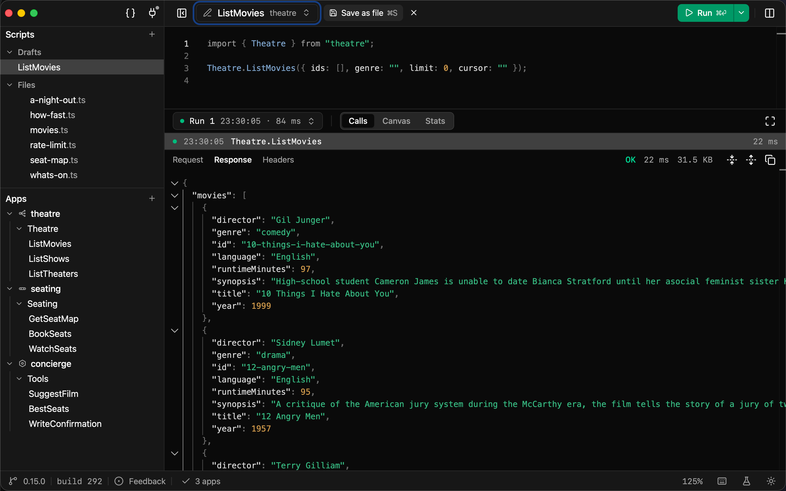

  

  <b>macOS · Docker</b>

<h3 align="center">API Stories</h3>

  The API client for people and agents.
   
  Connect gRPC, OpenAPI, or MCP. Explore APIs yourself, or let an agent write and run typed scripts.
   
  Every request stays visible and inspectable.

  
  &nbsp;
  

  <a href="https://kaja.tools/docs"><strong>Documentation</strong></a> ·
  <a href="https://demo.kaja.tools"><strong>Live Demo</strong></a> ·
  <a href="https://kaja.tools"><strong>Website</strong></a>

  
  
  

  

  

## Documentation

Installing Kaja, connecting apps, keeping credentials in variables, writing scripts
and pointing an agent at it are all documented on the website.

<h3 align="center">
  <a href="https://kaja.tools/docs">Read the docs at kaja.tools/docs →</a>
</h3>

|  |  |
| --- | --- |
| **[Installation](https://kaja.tools/docs#installation)** | The Mac App Store build, or one `docker run` with your protos and `kaja.json` mounted |
| **[Apps](https://kaja.tools/docs#apps)** | Connect gRPC, OpenAPI, Twirp and MCP apps, and what each type's block takes |
| **[Variables](https://kaja.tools/docs#variables)** | Named values your scripts and your app configuration both read, with secrets kept out of the file |
| **[Scripts](https://kaja.tools/docs#scripts)** | TypeScript with a typed import for every app you connected, drawing on the canvas |
| **[Agents](https://kaja.tools/docs#agents)** | Point your agent at Kaja's MCP server, and watch every run it makes |

## Development

Needs [Go](https://go.dev/doc/install) and [Bun](https://bun.sh/); the scripts offer to install them via [Homebrew](https://brew.sh).

- Server: `scripts/server` (add `--editable` to edit the workspace from the UI)
- Desktop: `scripts/desktop`
- iOS: `scripts/ios` for the simulator, `scripts/ios device` for an iPhone (needs full Xcode)
- Docker: `scripts/docker`
- Test: `(cd ui && bun test)` and `(cd server && go test ./... -tags development)`

### Releases

Every push to `main` uploads a macOS and iOS build to TestFlight. To ship, run the **release** workflow from GitHub Actions:

1. `open` with `patch`, `minor` or `major` opens a version bump PR. Merge it.
2. `ship` tags the release and publishes it on GitHub. Run it when a TestFlight build goes to the App Store.
